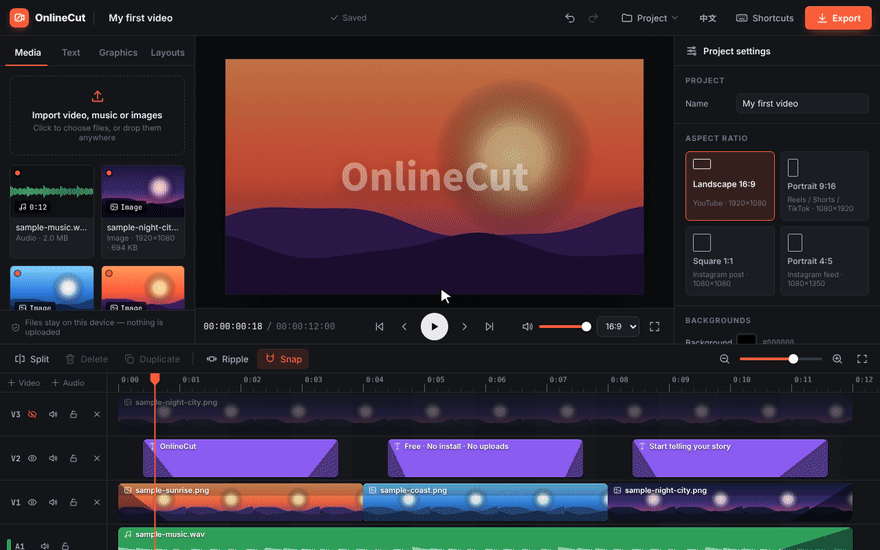

<div align="center">


# OnlineCut

**Edit videos right in your browser. Free, no install, no sign-up, and your files never leave your computer.**

**English** · [繁體中文](README.zh-TW.md) · [日本語](README.ja.md)

<a href="https://ymunick.github.io/OnlineCut/editor.html?lang=en"></a>

[](https://github.com/YMUNick/OnlineCut/actions/workflows/test.yml)
[](https://github.com/YMUNick/OnlineCut/actions/workflows/live-check.yml)
[](LICENSE)
[](#-privacy)
[](#-run-it-yourself)
[](#-contributing)
[](https://github.com/YMUNick/OnlineCut/stargazers)

<a href="https://ymunick.github.io/OnlineCut/editor.html?lang=en"></a>

</div>

## Why OnlineCut?

Most online editors make you **upload gigabytes of footage**, **sign up**, and then **put a watermark** on your export. OnlineCut skips all of that:

- **No upload wait.** Import a 10 GB file and start editing immediately. Everything is decoded, edited and encoded on your own device.
- **No account, no watermark, no paywall.** Open the page and start cutting. There's no server to pay for, so it stays free.
- **Nothing to install.** It's a static web page. It works in Chrome, Edge and Safari on any desktop.
- **Your work is safe.** Projects autosave in your browser, and you can download a `.onlinecut` file to back up or continue on another computer.

## ✨ Features

| | |
|---|---|
| 🎬 **Multi-track timeline** | Video, images, text and music on their own tracks. Drag, trim, split (`S`), ripple delete, snapping, auto-scroll at the edges. |
| 🪟 **Picture-in-picture & split screen** | One-click layouts: PiP in any corner, circle cam, side by side, top/bottom, three-way and 2×2. Adjust shape, border and shadow, and reframe inside the frame. |
| 🎨 **Built-in graphics** | 10 backgrounds, 9 stickers and 7 frames (Polaroid, film strip, cinematic bars, neon, viewfinder…). All vector, so they stay sharp at any size. |
| 🔤 **Titles & captions** | Six text presets, any font size, weight, color, box, outline and shadow. Drag, scale and rotate right on the preview. |
| 🎛️ **Filters, speed & fades** | Brightness, contrast, saturation, B&W and blur with presets; 0.25×–4× speed; volume up to 200%; fades you drag right on the timeline, with separate audio fades for video clips (e.g. let the music fade out while the picture stays). |
| 📐 **Any aspect ratio** | 16:9, 9:16 (Reels / Shorts / TikTok), 1:1 and 4:5. Portrait footage switches the canvas automatically. |
| 📦 **Frame-accurate MP4 export** | H.264 + AAC up to 1080p 60 fps, rendered frame by frame with WebCodecs, usually faster than real time. |
| 🐘 **Huge files welcome** | Large files aren't copied into the browser, and audio is streamed, so memory use doesn't grow with file size. |
| 🌐 **English & 繁體中文** | Picks your browser language automatically. Switch anytime from the top bar. |

## 🚀 Try it

**👉 [ymunick.github.io/OnlineCut](https://ymunick.github.io/OnlineCut/?lang=en)**

Click **Load sample project** to play with it in seconds. You don't need any footage.

## 🛠 Run it yourself

There's no build step. Any static file server works:

```bash
git clone https://github.com/YMUNick/OnlineCut && cd OnlineCut && npx serve
```

<details>
<summary>Other one-liners (Python, Docker) and GitHub Pages</summary>

```bash
python3 -m http.server 8080                                          # Python
docker run --rm -p 8080:80 -v "$PWD":/usr/share/nginx/html:ro nginx:alpine   # Docker
```

Then open <http://localhost:8080>. WebCodecs only works in a secure context (`https://` or `localhost`), so opening the file via `file://` falls back to WebM recording.

**Host your own copy for free:** fork the repo, then go to **Settings → Pages → Deploy from a branch → `main` / root**. Your copy will be live at `https://<you>.github.io/OnlineCut/`.

</details>

## 🔒 Privacy

OnlineCut is a purely static site with **no backend**. Imported files, edits and exports are processed by your browser and never uploaded anywhere. Projects are stored only in your browser's IndexedDB.

The only external request is Google Fonts (Noto Sans / Serif TC) for the interface and text styles.

## ⚙️ How export works

1. **Audio** is mixed in 30-second chunks: [mediabunny](https://mediabunny.dev) decodes only the range each chunk needs, and `OfflineAudioContext` applies volume, fades and speed. Memory use doesn't depend on timeline length or file size. If a file's audio can't be read, the export screen tells you instead of silently dropping it.
2. **Video** is decoded sequentially, each packet once. Formats mediabunny can't read fall back to seeking a `<video>` element.
3. Every frame is drawn to a canvas by the **same renderer as the preview**, then encoded with WebCodecs and muxed into MP4.
4. Without WebCodecs, OnlineCut records in real time with `MediaRecorder` instead.

On a 4-core machine with no GPU, a 20-second 1080p video exports in about 10 seconds.

<details>
<summary>Browser support, file formats and the <code>.onlinecut</code> project format</summary>

- **Editing:** recent Chrome, Edge, Safari and Firefox. Desktop recommended.
- **MP4 export:** needs WebCodecs H.264 encoding. Output is H.264 + AAC, or H.264 + Opus if AAC isn't available.
- **Fallback:** without WebCodecs, or when audio can't be encoded, `MediaRecorder` records in real time (WebM or MP4 depending on the browser).
- **Import:** whatever your browser can play: MP4 (H.264), WebM, MOV, MP3, WAV, M4A, OGG, JPG, PNG, WebP, GIF, SVG.
- Automated tests currently run on Chromium.

A `.onlinecut` file is a plain, uncompressed ZIP (any unzip tool can open it):

```
project.json             { format: "onlinecut-project", version: 1, includesMedia, project }
media/<media id>.<ext>   original media files (optional)
```

Every entry's CRC-32 is checked on open, and the project is fully validated and repaired (value ranges, overlapping clips, clips past the end of their media, resolution, unsafe ids), so a damaged or hand-edited file can't break the editor. Files re-zipped with deflate are accepted too.

</details>

## 🧪 Tests

```bash
npm test                 # 180+ unit tests, no dependencies
npm run test:e2e         # 75+ end-to-end tests in a real browser (needs ffmpeg + Playwright/Chromium)
ONLY=版型 npm run test:e2e        # run only tests whose (Chinese) name contains a keyword
```

- **Unit tests** include seeded fuzzing: thousands of random edits and corrupted save files. After every one, the project must still be valid (no overlaps, no clip past its media, at least one frame long).
- **End-to-end tests** generate media with ffmpeg, then import, play, edit, reload, open and save project files, and export real MP4s. The output is checked with ffprobe: duration, resolution, streams, and even pixel colors per region for split screens.
- **Translation tests** fail if any Chinese UI string is missing from the English dictionary. The English editor is also scanned screen by screen for untranslated text.
- After every GitHub Pages deploy, `live-check.yml` runs the whole end-to-end suite against the live site.

## 🤝 Contributing

Issues and PRs are welcome! The code is vanilla ES modules with no framework and no bundler:

```
assets/js/
  core/      pure logic, testable in Node: project model, layouts, time, undo/redo, project files
  media/     import, thumbnails, waveforms, IndexedDB storage
  engine/    renderer (shared by preview and export), player, exporter
  ui/        timeline, media library, graphics & layouts, inspector, preview, dialogs
  i18n.js    language detection + _t();  i18n-en.js is the English dictionary
tests/unit, tests/e2e
tools/make-media.mjs     regenerates the screenshots and demo GIFs
```

**Adding a language:** copy `i18n-en.js`, translate the values and register it in `i18n.js`. Point the checks in `tests/unit/i18n.test.js` at it and they'll list every string you still need to translate.

## 📄 License

[MIT](LICENSE). `assets/vendor/mediabunny.min.mjs` is [mediabunny](https://github.com/Vanilagy/mediabunny) 1.61.3 under the Mozilla Public License 2.0 (see `assets/vendor/mediabunny.LICENSE`), unmodified.

<div align="center">

**If OnlineCut saved you an upload or a watermark, a ⭐ helps other people find it.**

</div>
