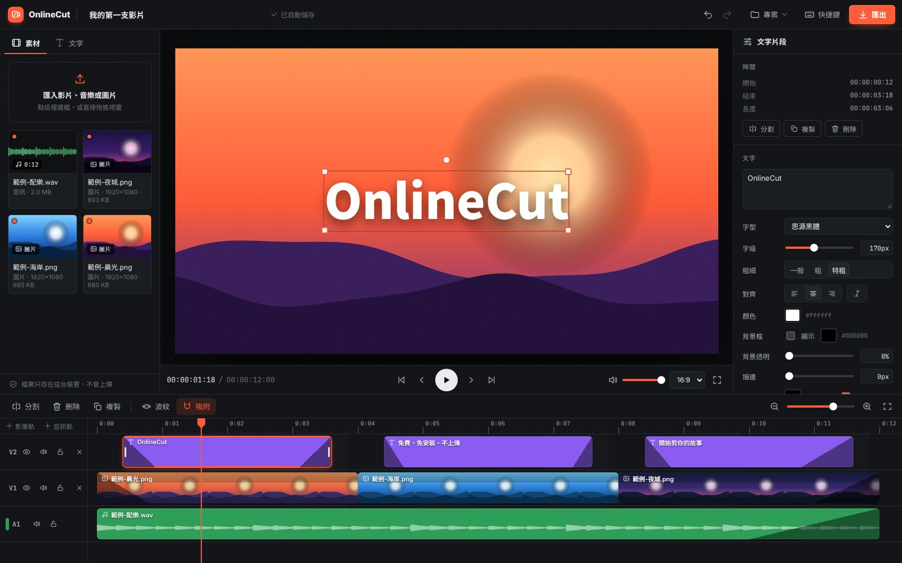

# OnlineCut

免費、免安裝、檔案不上傳的線上影片剪輯器。打開瀏覽器就能剪影片，所有處理都在你的電腦上完成。



## 功能

- **多軌時間軸**：影片、圖片、文字、音樂各自一條軌，可以新增軌道。拖曳移動（可跨軌）、拉邊緣修剪、在播放頭分割、複製、波紋刪除（刪除後自動補位），片段會吸附到播放頭和其他片段的邊緣。
- **預覽畫面直接操作**：點選圖層，拖曳移動、拉角縮放、拖頂端旋轉，靠近中心會自動對齊。
- **文字**：六種樣板（大標題、副標題、字幕、標籤、描邊大字、襯線引言），可調整字型、大小、粗細、斜體、對齊、顏色、背景框、描邊、陰影。
- **濾鏡**：亮度、對比、飽和度、黑白、模糊，加上六個預設。
- **聲音與速度**：音量 0–200%、靜音、0.25×–4× 變速，畫面與聲音的淡入淡出，軌道靜音、隱藏、鎖定。
- **畫面比例**：16:9、9:16、1:1、4:5。匯入直式影片到空專案時會自動切換。
- **匯出 MP4**：H.264 + AAC（瀏覽器不支援 AAC 時用 Opus），可選原始 / 1080p / 720p / 480p、24 / 30 / 60 fps、三種畫質。
- **自動儲存**：專案和素材存在瀏覽器的 IndexedDB，重新整理後接著做。
- **專案檔（.onlinecut）**：下載整個專案（可選擇包含素材）來備份或換電腦，開啟時會檢查檔案是否完整。只存設定的專案檔開啟後，重新匯入同名、同大小的原始檔就會自動接回。
- **復原 / 重做**、完整鍵盤快捷鍵（按 `?` 查看）。

## 隱私

OnlineCut 是純前端的靜態網站，沒有後端伺服器。匯入的檔案、剪輯和輸出都在瀏覽器裡處理，不會上傳到任何地方。專案資料只存在使用者自己的瀏覽器裡。

唯一的外部連線是從 Google Fonts 載入介面與文字使用的思源黑體 / 宋體。

## 專案檔格式

`.onlinecut` 是一般的 ZIP 檔（不壓縮，任何解壓縮軟體都能打開）：

```
project.json             { format: "onlinecut-project", version: 1, includesMedia, project }
media/<素材 id>.<副檔名>   素材原始檔（可選）
```

開啟時會檢查每個檔案的 CRC-32；專案資料會經過完整的驗證與修正（數值範圍、重疊片段、超出素材長度、解析度、不安全的 id），所以損毀或被修改過的檔案不會讓編輯器出錯。也接受用一般壓縮軟體重新壓縮過（deflate）的檔案。

## 匯出是怎麼做的

1. 用 `OfflineAudioContext` 把所有聲音（含音量、淡入淡出、變速）混成一段音軌。
2. 每段影片用 [mediabunny](https://mediabunny.dev) 依序解碼，每個封包只解一次；它不支援的格式會退回用 `<video>` 逐格定位。
3. 每一格畫到 canvas 上（跟預覽用同一套 renderer），再用 WebCodecs 編碼、封裝成 MP4。
4. 瀏覽器沒有 WebCodecs 時，改用 `MediaRecorder` 即時錄製成 WebM。

在只有 4 顆 CPU、沒有 GPU 的測試環境中，20 秒的 1080p 影片約 10 秒就能匯出完成。

## 瀏覽器支援

- **剪輯**：近年版本的 Chrome、Edge、Safari、Firefox 都能使用。建議用電腦操作。
- **匯出 MP4**：需要瀏覽器支援 WebCodecs 的 H.264 編碼。支援 AAC 時輸出 H.264 + AAC，只支援 Opus 時輸出 H.264 + Opus。
- **備援**：沒有 WebCodecs，或專案有聲音但瀏覽器無法編碼音訊時，改用 `MediaRecorder` 即時錄製（WebM 或 MP4，視瀏覽器而定），需要完整播放一次並留在分頁上。
- 自動化測試目前在 Chromium 上執行；其他瀏覽器還沒有實測。

可以匯入的格式取決於瀏覽器能播放什麼：常見的 MP4（H.264）、WebM、MOV、MP3、WAV、M4A、OGG、JPG、PNG、WebP、GIF、SVG。

## 在本機執行

不需要建置，任何靜態伺服器都可以：

```bash
python3 -m http.server 8080
# 打開 http://localhost:8080
```

WebCodecs 只能在安全環境下使用（`https://` 或 `localhost`），直接用 `file://` 開啟時匯出會退回 WebM。

## 部署到 GitHub Pages

到 repo 的 **Settings → Pages**，Source 選 **Deploy from a branch**，分支選 `main`、資料夾選 `/ (root)`。幾分鐘後網站就會出現在 `https://<帳號>.github.io/OnlineCut/`。

## 專案結構

```
index.html                 首頁
editor.html                編輯器
assets/
  css/                     base（設計 token）、editor、landing
  js/
    core/                  純資料邏輯（可在 Node 測試）：專案模型、時間、undo/redo
    media/                 匯入、縮圖、波形、IndexedDB 儲存
    engine/                畫面合成（renderer）、播放（player）、匯出（exporter）
    ui/                    時間軸、素材庫、屬性面板、預覽操作、對話框
    app.js                 把所有模組接起來
  vendor/                  mediabunny（MPL-2.0）
tests/
  unit/                    node:test 單元測試
  e2e/run.mjs              Playwright 端到端測試
```

## 測試

```bash
# 單元測試（不需要安裝任何東西）
npm test

# 端到端測試：需要 ffmpeg，以及 Playwright + Chromium
npm install --no-save playwright
npx playwright install chromium
npm run test:e2e
```

端到端測試會用 ffmpeg 產生測試素材，在真的瀏覽器裡匯入、播放、剪輯、重新整理，再匯出 MP4 並用 ffprobe 檢查長度、解析度、影音軌和畫面內容；也涵蓋專案檔的來回、損毀檔案、遺失素材重新連結，以及多分頁、空間不足等邊界情況。

單元測試包含隨機壓力測試：用固定種子隨機做上萬次編輯、餵入大量損毀的存檔，檢查專案永遠保持合法（片段不重疊、不超出素材長度、至少一格長）。

對已部署的網站跑端到端測試：

```bash
BASE_URL=https://ymunick.github.io/OnlineCut npm run test:e2e
```

GitHub Pages 每次部署完成後，`live-check.yml` 會自動執行這組測試。

## 授權

OnlineCut 以 [MIT](LICENSE) 授權釋出。

`assets/vendor/mediabunny.min.mjs` 來自 [mediabunny](https://github.com/Vanilagy/mediabunny) 1.61.3，以 Mozilla Public License 2.0 授權（見 `assets/vendor/mediabunny.LICENSE`），未經修改。
