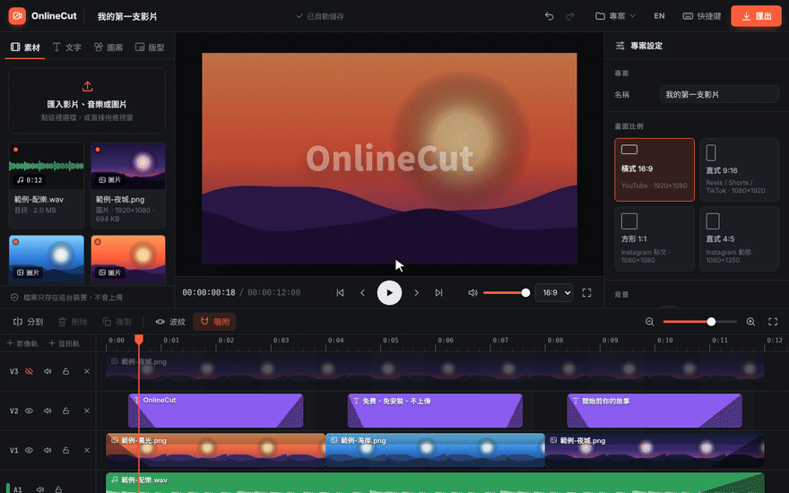

<div align="center">


# OnlineCut

**打開瀏覽器就能剪影片。免費、免安裝、免註冊，檔案不會離開你的電腦。**

[English](README.md) · **繁體中文** · [日本語](README.ja.md)

<a href="https://ymunick.github.io/OnlineCut/editor.html?lang=zh-TW"></a>

[](https://github.com/YMUNick/OnlineCut/actions/workflows/test.yml)
[](https://github.com/YMUNick/OnlineCut/actions/workflows/live-check.yml)
[](LICENSE)
[](#-隱私)
[](#-自己架設)
[](#-參與開發)
[](https://github.com/YMUNick/OnlineCut/stargazers)

<a href="https://ymunick.github.io/OnlineCut/editor.html?lang=zh-TW"></a>

</div>

## 為什麼用 OnlineCut？

大部分線上剪輯工具要你先**上傳好幾 GB 的影片**、**註冊帳號**，匯出時還**加上浮水印**。OnlineCut 全部省掉：

- **不用等上傳**：10GB 的檔案匯入後馬上開始剪，解碼、剪輯、編碼都在你自己的電腦上完成。
- **不用帳號、沒有浮水印、沒有付費牆**：打開網頁就能剪。沒有伺服器要付錢，所以可以一直免費。
- **不用安裝**：就是一個靜態網頁，電腦版 Chrome、Edge、Safari 都能用。
- **不怕做到一半不見**：專案自動存在瀏覽器裡，也能下載 `.onlinecut` 專案檔備份，或帶到另一台電腦繼續剪。

## ✨ 功能

| | |
|---|---|
| 🎬 **多軌時間軸** | 影片、圖片、文字、音樂各自一條軌。拖曳、修剪、分割（`S`）、波紋刪除、吸附，拖到邊緣會自動捲動。 |
| 🪟 **雙畫面版型** | 一鍵套用：四個角落的子母畫面、圓形小窗、左右 / 上下分割、三分割、四宮格。形狀、邊框、陰影可調，框裡的取景也能調整。 |
| 🎨 **內建圖案** | 23 種可以改字的文字貼圖（爆炸標、對話框、思考泡泡、霓虹燈牌、印章、紙膠帶、姓名字幕條、直播中…）、18 種背景、24 種貼圖、13 種邊框裝飾（拍立得、漫畫集中線、直播畫面、下雪、愛心飄落…），全部是向量圖，放大也清楚。 |
| 🔤 **文字與字幕** | **在預覽畫面上點兩下文字就能直接改字**，同時換字型、字級、粗細、顏色。15 種一鍵文字樣式（霓虹字、綜藝大字、手寫筆記、電影字幕、打字機…）、11 種字型（含霞鶩文楷、粉圓體），描邊、陰影、發光與 17 種外框造型。 |
| ⬛ **純色畫面與數字倒數** | 一鍵在播放頭插入全黑、全白或自訂顏色的畫面（後面的片段自動往後移）；文字裡的數字可以從 2152 倒數到 2132，越接近越慢。 |
| ✂️ **AI 剪成短影音** | 用同一把 API Key，AI 讀懂逐字稿、挑出最精彩的幾句（最吸引人的放開頭），自動剪成約 15 / 30 / 60 秒的 Shorts、Reels：直式 9:16、畫面填滿、加上字幕、背景音樂不剪斷。不滿意按一次復原就回到原本的影片。 |
| 🔀 **轉場** | 10 種轉場：溶解、黑場過渡、白場閃光、模糊溶接、擦除、柔和漸層擦除、推移、往上推移、圓形展開、放大溶接。點一下加在接點上，或一次套用到全部接點，長度可調。 |
| 🤖 **AI 自動上字幕** | 設定自己的 API Key（OpenAI Whisper、Groq 或任何 OpenAI 相容的服務），把說話內容變成字幕，自動切成好讀的長度、一句一段放到字幕軌，每段都能再修改，字型、顏色、背景、位置可以整軌一起改；長影片會分段上傳，也能下載 `.srt`。 |
| 🎛️ **濾鏡、變速、淡入淡出** | 亮度、對比、飽和度、黑白、模糊與預設；0.25×–4× 變速；音量最高 200%；在時間軸上直接拖曳就能調淡入淡出，影片的聲音還能跟畫面分開淡出（例如畫面不變、聲音慢慢變小）。 |
| 📐 **各種畫面比例** | 16:9、9:16（Reels / Shorts / TikTok）、1:1、4:5。匯入直式影片會自動切換。 |
| 📦 **逐格精準匯出 MP4** | H.264 + AAC，最高 1080p 60fps；用 WebCodecs 逐格渲染，通常比即時播放還快。 |
| 🐘 **大檔案也沒問題** | 大檔案不複製進瀏覽器，聲音用串流方式解碼，記憶體用量跟檔案大小無關。 |
| 🌐 **中文 / English** | 依瀏覽器語言自動切換，右上角隨時可以換。 |

## 🚀 馬上試試

**👉 [ymunick.github.io/OnlineCut](https://ymunick.github.io/OnlineCut/?lang=zh-TW)**

沒有影片也沒關係，按「載入範例專案」幾秒鐘就能玩。

## 🛠 自己架設

不需要建置，任何靜態伺服器都可以：

```bash
git clone https://github.com/YMUNick/OnlineCut && cd OnlineCut && npx serve
```

<details>
<summary>其他一行指令（Python、Docker）與 GitHub Pages</summary>

```bash
python3 -m http.server 8080                                          # Python
docker run --rm -p 8080:80 -v "$PWD":/usr/share/nginx/html:ro nginx:alpine   # Docker
```

打開 <http://localhost:8080>。WebCodecs 只能在安全環境（`https://` 或 `localhost`）使用，直接用 `file://` 開啟時匯出會退回 WebM。

**免費架一份自己的**：Fork 這個 repo，到 **Settings → Pages → Deploy from a branch → `main` / root**，幾分鐘後就會出現在 `https://<帳號>.github.io/OnlineCut/`。

</details>

## 🔒 隱私

OnlineCut 是純前端的靜態網站，**沒有後端**。匯入的檔案、剪輯和輸出都在瀏覽器裡處理，不會上傳到任何地方；專案資料只存在你自己瀏覽器的 IndexedDB。

唯一的外部連線是從 Google Fonts 載入介面與文字使用的思源黑體 / 宋體。只有你自己按下 **AI 自動上字幕** 時，聲音（不含畫面）會用你的 API Key 直接從瀏覽器傳到你選的語音辨識服務，不會經過 OnlineCut 的伺服器；API Key 只有在勾選「記住」時才會存在你的瀏覽器裡。

## ⚙️ 匯出是怎麼做的

1. **聲音**每 30 秒一段：用 [mediabunny](https://mediabunny.dev) 只解碼這段用到的素材範圍，再用 `OfflineAudioContext` 混音（含音量、淡入淡出、變速）。記憶體用量跟時間軸長度和檔案大小都無關；有素材的聲音讀不到時，完成畫面會列出來，不會默默沒聲音。
2. **影片**依序解碼，每個封包只解一次；mediabunny 不支援的格式會退回用 `<video>` 逐格定位。
3. 每一格都用**跟預覽同一套的 renderer** 畫到 canvas 上，再用 WebCodecs 編碼、封裝成 MP4。
4. 瀏覽器沒有 WebCodecs 時，改用 `MediaRecorder` 即時錄製。

在只有 4 顆 CPU、沒有 GPU 的環境中，20 秒的 1080p 影片約 10 秒就能匯出完成。

<details>
<summary>瀏覽器支援、檔案格式與 <code>.onlinecut</code> 專案檔格式</summary>

- **剪輯**：近年版本的 Chrome、Edge、Safari、Firefox 都能使用，建議用電腦操作。
- **匯出 MP4**：需要瀏覽器支援 WebCodecs 的 H.264 編碼。支援 AAC 時輸出 H.264 + AAC，只支援 Opus 時輸出 H.264 + Opus。
- **備援**：沒有 WebCodecs，或無法編碼音訊時，改用 `MediaRecorder` 即時錄製（WebM 或 MP4，視瀏覽器而定）。
- **可以匯入**：瀏覽器能播放的格式，例如 MP4（H.264）、WebM、MOV、MP3、WAV、M4A、OGG、JPG、PNG、WebP、GIF、SVG。
- 自動化測試目前在 Chromium 上執行。

`.onlinecut` 是一般的 ZIP 檔（不壓縮，任何解壓縮軟體都能打開）：

```
project.json             { format: "onlinecut-project", version: 1, includesMedia, project }
media/<素材 id>.<副檔名>   素材原始檔（可選）
```

開啟時會檢查每個檔案的 CRC-32，專案資料會經過完整的驗證與修正（數值範圍、重疊片段、超出素材長度、解析度、不安全的 id），損毀或被修改過的檔案不會讓編輯器出錯。也接受用一般壓縮軟體重新壓縮過（deflate）的檔案。

</details>

## 🧪 測試

```bash
npm test                 # 200 多個單元測試，不需要安裝任何東西
npm run test:e2e         # 95 個以上的端到端測試（需要 ffmpeg 與 Playwright / Chromium）
ONLY=版型 npm run test:e2e        # 只跑名稱包含關鍵字的測試
```

- **單元測試**包含隨機壓力測試：用固定種子做上萬次隨機編輯、餵入大量損毀的存檔，每一步之後專案都必須合法（片段不重疊、不超出素材長度、至少一格長）。
- **端到端測試**用 ffmpeg 產生素材，在真的瀏覽器裡匯入、播放、剪輯、重新整理、開啟與下載專案檔，再匯出 MP4，用 ffprobe 檢查長度、解析度、影音軌，分割畫面還會檢查每一區的顏色。
- **翻譯測試**：介面上任何一句中文沒有英文翻譯，測試就會失敗；英文版也會逐一打開各個畫面，確認沒有漏翻。
- GitHub Pages 每次部署完成後，`live-check.yml` 會對線上網站跑一次完整的端到端測試。

## 🤝 參與開發

歡迎開 issue 或 PR！程式是原生 ES modules，沒有框架、沒有打包工具：

```
assets/js/
  core/      純資料邏輯（可在 Node 測試）：專案模型、版型、時間、undo/redo、專案檔
  media/     匯入、縮圖、波形、IndexedDB 儲存
  engine/    畫面合成（預覽與匯出共用）、播放、匯出
  ui/        時間軸、素材庫、圖案與版型、屬性面板、預覽操作、對話框
  i18n.js    語言判斷與 _t()；i18n-en.js 是英文字典
tests/unit、tests/e2e
tools/make-media.mjs     重新產生截圖與示範 GIF
```

**新增語言**：複製 `i18n-en.js` 翻譯成新的語言，在 `i18n.js` 登記；把 `tests/unit/i18n.test.js` 的檢查指向新字典，就會列出還沒翻譯的每一句。

## 📄 授權

[MIT](LICENSE)。`assets/vendor/mediabunny.min.mjs` 來自 [mediabunny](https://github.com/Vanilagy/mediabunny) 1.61.3，以 Mozilla Public License 2.0 授權（見 `assets/vendor/mediabunny.LICENSE`），未經修改。

<div align="center">

**如果 OnlineCut 幫你省下了上傳時間或浮水印，按個 ⭐ 讓更多人找到它。**

</div>
